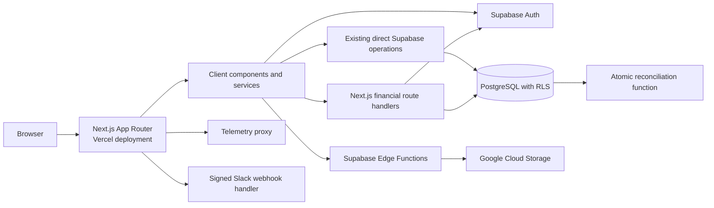

# Architecture

This document describes the implementation on the Next.js migration branch. The pull request is not yet merged; the existing production deployment may differ. The application uses Next.js App Router and React client components, with Supabase Auth and PostgreSQL as the production backend. Its financial BFF is incremental: many existing workflows still use the Supabase client directly.

## System context



The GCS upload path uses the `gcs-signed-url` Edge Function and a short-lived Google access token. Other integrations and Supabase functions remain in place. Public registration metadata is generated server-side; `/api/registro` is rewritten to `/registro`. Slack requests to the Next.js handler require a valid signature and timestamp.

## Financial request and tenant boundaries

```mermaid
sequenceDiagram
  participant Browser
  participant BFF as Next.js route handler
  participant Auth as Supabase Auth
  participant DB as PostgreSQL / RLS
  Browser->>BFF: Bearer token and financial command
  BFF->>Auth: Validate user token
  BFF->>DB: Load profile, tenant and role as user
  BFF->>BFF: Authorize role and validate command
  BFF->>DB: Write using user token and tenant scope
  Note over DB: RLS applies; tenant-reference triggers provide additional checks
  DB-->>BFF: Result or error
  BFF-->>Browser: JSON response
```

`src/server/authenticatedTenant.ts` validates the bearer token, loads the user profile and checks role and approval. The BFF uses the anonymous key with the user's token, not a service-role key. Current handlers cover internal income (`/api/incomes/internal`), expense registration (`/api/expenses`), expense audit (`/api/expenses/audit`) and reconciliation (`/api/reconciliation`). Their validation and role rules differ by operation; RLS remains the database enforcement layer.

Reconciliation calls `reconcile_financial_record`, a security-invoker PostgreSQL function that locks the pending bank transaction and updates both records in one transaction. The tenant-reference migration checks the relevant references on writes. Neither migration should be assumed applied to a remote database; audit existing references before deployment. The UI and database policies currently disagree on some expense-audit roles and require a business decision.

## Local execution and testing

Without configured Supabase values, the app runs in simulation using browser localStorage and seeded data. Playwright builds with placeholder configuration and blocks external requests; it exercises UI flows, not real database access or RLS. `npm run test:postgres` tests the reconciliation migration in a disposable PostgreSQL container with a minimal fixture schema and test policies. The optional local Supabase integration suite covers the fuller schema and RLS; it is separate from the browser safety net. See [migration notes](docs/nextjs-migration.md) for commands and release prerequisites.

## Code map

- `src/app/`: routes, layouts and route handlers.
- `src/features/` and `src/components/`: feature screens and shared UI; some compatibility wrappers still use React Router.
- `src/context/`: authentication and notification state.
- `src/services/`: existing client services, BFF client and command validation.
- `src/server/`: server-side authentication and tenant resolution.
- `supabase/migrations/`, `supabase/functions/`: database changes and Edge Functions.
- `e2e/`: Playwright simulation flows; `tests/local-postgres/`: focused SQL fixtures.

The intended direction is to move more workflows behind application services and persistence ports. Subscription entitlements, trial enforcement, recovery objectives and broader operational monitoring remain roadmap work, not current capabilities.

Architecture decisions are recorded in [docs/adr](docs/adr/).
